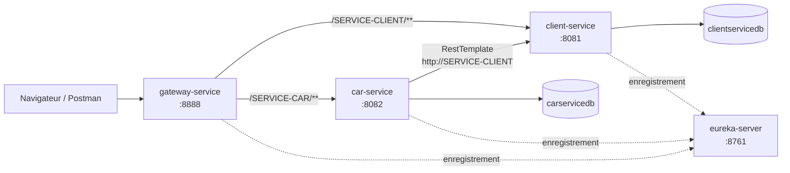
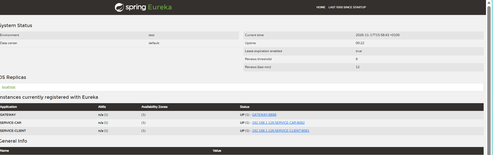
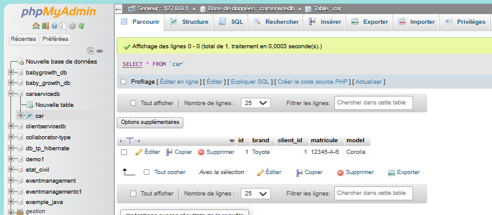
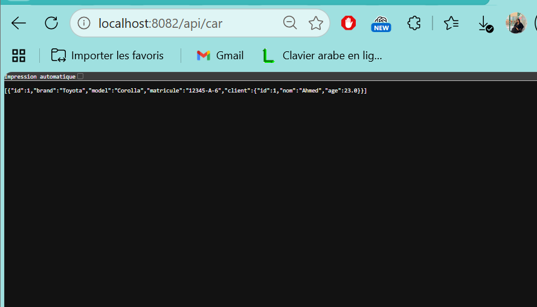
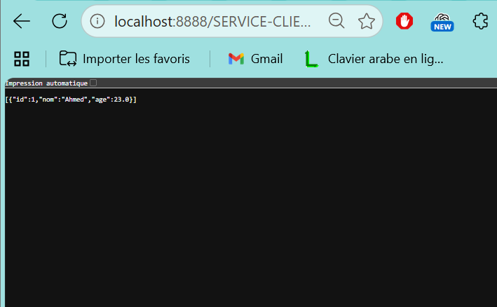
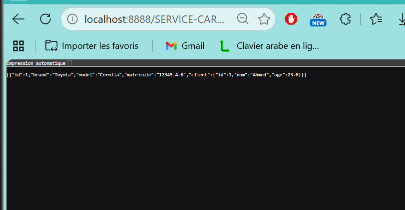

# TP20 – Architecture Microservices avec Eureka, Gateway et RestTemplate

**Auteur :** Hibatalah Hamrani – 5ème année DDSI, EMSI Marrakech
**Module :** Frameworks et architecture microservices

## Objectif

Mettre en place une architecture microservices composée de :

- un **serveur de découverte** (Eureka) où tous les services s'enregistrent ;
- une **API Gateway** qui sert de point d'entrée unique ;
- deux microservices métier, **client-service** et **car-service**, chacun avec sa propre base MySQL ;
- une **communication inter-services** : `car-service` récupère les informations du client d'une voiture en appelant `client-service` avec **RestTemplate**, en résolvant son adresse via Eureka (`@LoadBalanced`).

## Architecture



| Module | Nom dans Eureka | Port | Rôle |
|---|---|---|---|
| `eureka-server` | – | 8761 | Annuaire des services |
| `gateway-service` | `GATEWAY` | 8888 | Point d'entrée, routage vers les services |
| `client-service` | `SERVICE-CLIENT` | 8081 | Gestion des clients (base `clientservicedb`) |
| `car-service` | `SERVICE-CAR` | 8082 | Gestion des voitures (base `carservicedb`) + appel de client-service |

## Technologies

- Java 17
- Spring Boot 3.5.15
- Spring Cloud 2025.0.3 (Netflix Eureka, Spring Cloud Gateway, LoadBalancer)
- Spring Data JPA / Hibernate
- MySQL (MariaDB via XAMPP)
- Lombok
- Maven (projet multi-modules)

## Modèle de données

**Client** (`client-service`)

| Champ | Type |
|---|---|
| `id` | Long |
| `nom` | String |
| `age` | Float |

**Car** (`car-service`)

| Champ | Type |
|---|---|
| `id` | Long |
| `brand` | String |
| `model` | String |
| `matricule` | String |
| `client_id` | Long |

`car-service` ne stocke que l'identifiant du client. Lors d'une lecture, il renvoie un `CarResponse` dans lequel le client complet est récupéré depuis `client-service` :

```json
{
  "id": 1,
  "brand": "Toyota",
  "model": "Corolla",
  "matricule": "12345-A-6",
  "client": { "id": 1, "nom": "Ahmed", "age": 23.0 }
}
```

## Endpoints

**client-service** (`/api/client`)

| Méthode | URL | Description |
|---|---|---|
| GET | `/api/client` | Liste des clients |
| GET | `/api/client/{id}` | Un client par son id |
| POST | `/api/client` | Ajouter un client |

**car-service** (`/api/car`)

| Méthode | URL | Description |
|---|---|---|
| GET | `/api/car` | Liste des voitures avec leur client |
| GET | `/api/car/{id}` | Une voiture avec son client |

La gateway expose chaque service sous son nom Eureka : `http://localhost:8888/<NOM-DU-SERVICE>/...`

## Lancement

### Prérequis

- JDK 17 ou plus
- Maven
- MySQL / MariaDB démarré sur le port 3306 (utilisateur `root`, mot de passe vide par défaut avec XAMPP)

Les bases `clientservicedb` et `carservicedb` sont créées automatiquement au démarrage (`createDatabaseIfNotExist=true`) et les tables sont générées par Hibernate (`ddl-auto: update`).

### Compilation

```bash
mvn clean package -DskipTests
```

### Ordre de démarrage

1. `eureka-server`, puis vérifier http://localhost:8761
2. `client-service`
3. `car-service`
4. `gateway-service`

Chaque service peut être lancé depuis IntelliJ ou avec :

```bash
java -jar eureka-server/target/eureka-server-1.0.0.jar
java -jar client-service/target/client-service-1.0.0.jar
java -jar car-service/target/car-service-1.0.0.jar
java -jar gateway-service/target/gateway-service-1.0.0.jar
```

## Tests

1. Ajouter un client :

```powershell
Invoke-RestMethod -Method Post -Uri http://localhost:8081/api/client -ContentType "application/json" -Body '{"nom":"Ahmed","age":23}'
```

2. Ajouter une voiture liée à ce client. `car-service` n'expose pas de POST, l'insertion se fait donc en SQL dans `carservicedb` :

```sql
INSERT INTO car (brand, model, matricule, client_id)
VALUES ('Toyota', 'Corolla', '12345-A-6', 1);
```

3. Lire les données :

| Test | URL |
|---|---|
| Clients (direct) | http://localhost:8081/api/client |
| Voitures (direct) | http://localhost:8082/api/car |
| Clients via la gateway | http://localhost:8888/SERVICE-CLIENT/api/client |
| Voitures via la gateway | http://localhost:8888/SERVICE-CAR/api/car |

## Captures d'écran

### Eureka : les 3 services enregistrés (UP)



### Base de données `carservicedb`

La table `car` ne contient que `client_id`, pas les informations du client.



### car-service en direct (port 8082)

La réponse contient le client complet, récupéré depuis `client-service` avec RestTemplate.



### client-service via la gateway



### car-service via la gateway

Chaîne complète : gateway → car-service → (RestTemplate + Eureka) → client-service → MySQL.

